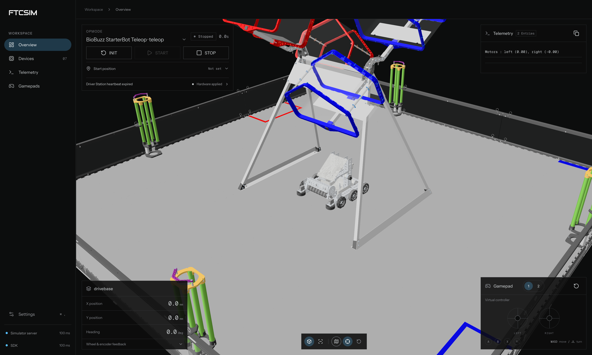
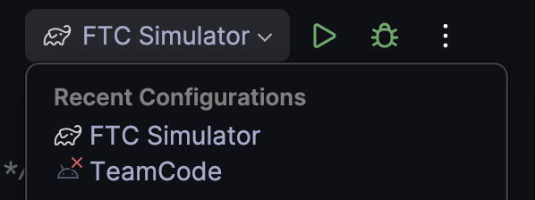

<h1 align="center">ftcsim</h1>
<p align="center">A desktop runtime and simulator for FTC robot code.</p>



<br>

**ftcsim is not another FTC gameplay simulator.** It is a tool for software teams to directly test their robot's code without access to the physical robot. It works by swapping out the FtcRobotController for a custom version that communicates with a Python server. This server keeps track of motor states, sensor readings, and every other peripheral you could connect to a Lynx module. You can then configure your robot in the web driver station, which allows you to upload custom CAD models, change your hardware map, and configure mechanisms. Your code, ideally, never realizes it's not running on the real robot, giving you an accurate test platform for your robot's software.

## Installation and Setup

Make sure you have Python 3.10+ and Android Studio (which I would hope you do) installed
```sh
pip install ftcsim
```

**Setup**
```sh
cd /path/to/your/FTC-project
ftcsim --wizard
```
This will install the TeamCodeSim package and desktop version of the SDK into your project. It'll also add Gradle tasks to run the simulator. Don't worry, the normal robot target will still work normally.

## Usage

Either in the Android Studio terminal or in another window run the robot simulator and driver station server.
```sh
ftcsim
```

You can use the Driver Station at [localhost:9015/ds/](http://localhost:9015/ds/).

Run `./gradlew runSimulator` in the robot project to launch its SDK and TeamCode. You can also change the Gradle target in Android Studio to run it from your IDE.



## Progress and Shortcomings

ftcsim is still missing some features. Most importantly, it lacks drivers/peripherals for the Lynx module. For multi-motor or velocity-based feedback software to work, we also need to define mechanisms that link motor/servo output to sensor readings. Right now, I have a simple mecanum drive mechanism and a tank drive mechanism implemented, but they also need more odometry options. I also need to implement more drivebases and other miscellaneous mechanisms like flywheels.

## Development

Source builds require Python 3.10+, JDK 17+, Node.js 22.12+, and npm

```sh
python3 -m pip install -e .
ftcsim --dev
```

Run `npm ci` and `npm run dev` in `driver-station/` for frontend development

```sh
python3 -m pip install build
python3 -m build
```

The Python build runs `scripts/build_driver_station.py` and
`scripts/build_sdk.py`. They compile the frontend and JVM libraries into the package. Either script can also be run
independently.

## License
This project is made by [@simplyrohan](https://github.com/simplyrohan) at 29619 Axiom Robotics. ftcsim is licensed under [GNU GPL v3](LICENSE). The bundled FTC SDK keeps its [license](sdk/LICENSE).

> [!IMPORTANT]
> I personally do not support using AI vibecoding in or out of FTC because it generally leads to lower-quality software, goes against FIRST's educational goals, and stops software innovation. That said, this project was built heavily with AI because it will be completely obsolete by the next FTC season, and the effort and time it would take to build it without AI wouldn't be worth the results.
